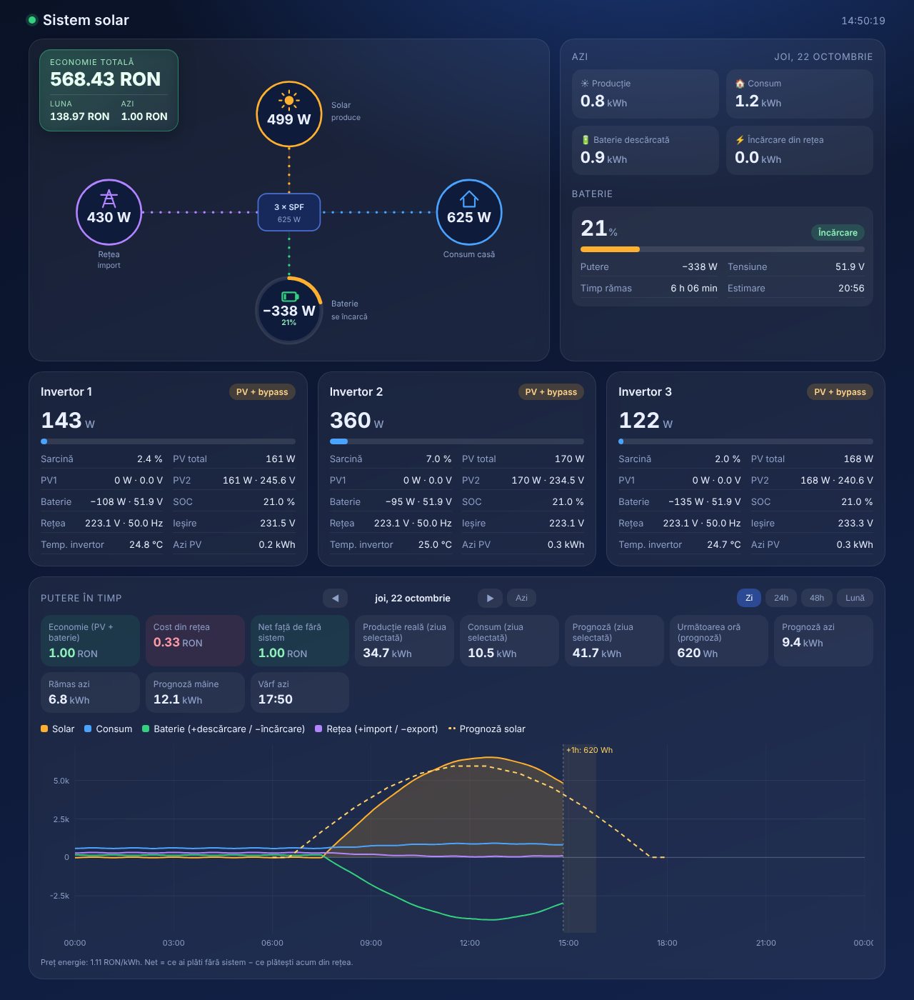
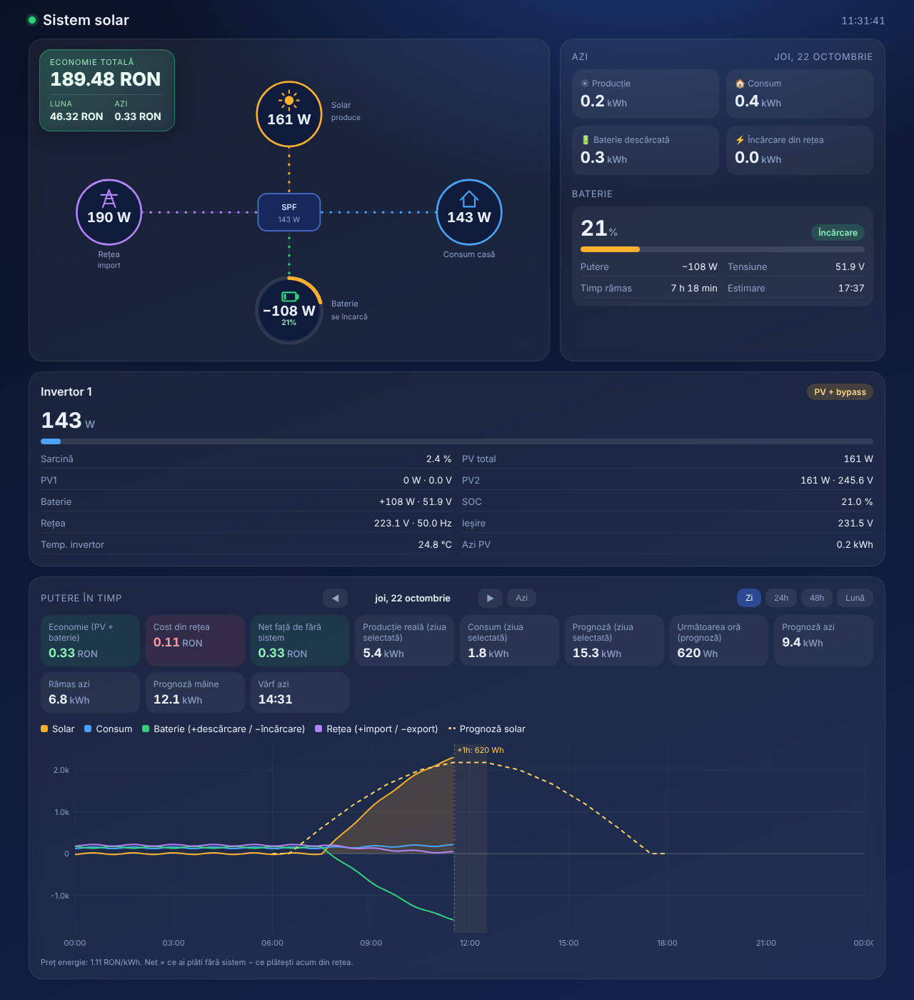
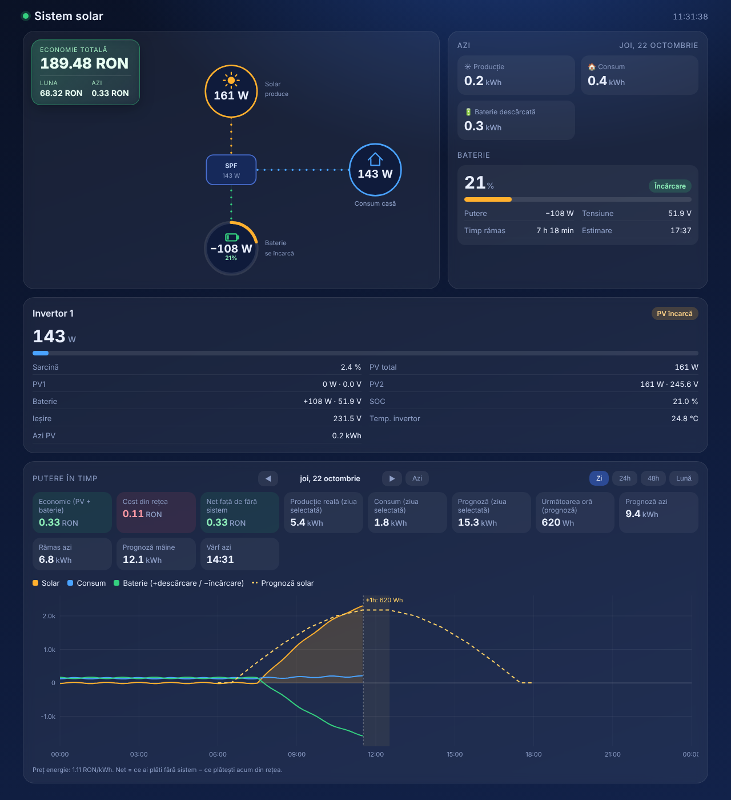

# DongleGrowatt – step-by-step guide (English)

> Română: [GHID.ro.md](GHID.ro.md)

DongleGrowatt turns a Growatt **ShineWiFi-X2** stick into a local gateway for a Growatt **SPF** off-grid inverter. You flash it once; everything else is set in the browser. It reads the inverter every few seconds, sends the values to the MQTT server you choose, and answers Modbus TCP requests on port 502.

**Contents**

1. [What you need](#1-what-you-need)
2. [Download the firmware](#2-download-the-firmware)
3. [Open the stick and wire the adapter](#3-open-the-stick-and-wire-the-adapter)
4. [Check the chip and back up the Growatt firmware](#4-check-the-chip-and-back-up-the-growatt-firmware)
5. [Flash DongleGrowatt](#5-flash-donglegrowatt)
6. [First start: the DongleGrowatt hotspot](#6-first-start-the-donglegrowatt-hotspot)
7. [Dongle settings page](#7-dongle-settings-page)
8. [Plug it into the inverter](#8-plug-it-into-the-inverter)
9. [MQTT data](#9-mqtt-data)
10. [Home Assistant](#10-home-assistant)
11. [Modbus TCP](#11-modbus-tcp)
12. [Updates](#12-updates)
13. [Troubleshooting](#13-troubleshooting)
14. [Going back to the Growatt firmware](#14-going-back-to-the-growatt-firmware)

---

## 1. What you need

- A Growatt ShineWiFi-X2 stick (tested board: **B700.0198800**, ESP32-C3 module ESP-C3-13U)
- A USB-TTL adapter that can run at **3.3 V** (CP2102, CH340 or FT232), and a few dupont wires
- A PC with Python (Windows: `winget install Python.Python.3.12`), then `python -m pip install esptool`
- An MQTT server: Mosquitto in Home Assistant, HiveMQ Cloud, or any other

Never connect 5 V to the stick, never run `espefuse burn-...` commands, and keep the backup from step 4. You do this at your own risk.

## 2. Download the firmware

Open the repository's **Releases** page and download:

| File | Used for |
| --- | --- |
| `DongleGrowatt.factory.bin` | the first flash, by cable (contains the scripts) |
| `DongleGrowatt.bin` | later updates from the dongle's web page |
| `growatt.be`, `autoexec.be` | the driver scripts, in case you update them separately |

Between releases, the latest build is under **Actions → Build firmware → (latest run) → Artifacts**.

## 3. Open the stick and wire the adapter

Remove the two screws and slide the board out. Next to the metal module there is a 7-hole header: `3.3V · G · TX0 · RX0 · RST · IO9 · G`.

Take the stick out of the inverter and out of any USB port, then wire:

| Adapter | Stick |
| --- | --- |
| GND | G |
| 3V3 (not 5V) | 3.3V |
| TXD | RX0 |
| RXD | TX0 |
| — | IO9 bridged to G (download mode) |

Plug the adapter into the PC and note its port (Windows: Device Manager → Ports, e.g. `COM7`). With the IO9 bridge in place, unplug and replug the adapter before **every** esptool command below.

## 4. Check the chip and back up the Growatt firmware

```
python -m esptool --chip esp32c3 -p COM7 --before no-reset chip-id
python -m esptool --chip esp32c3 -p COM7 --before no-reset get-security-info
```

You need `ESP32-C3`, **Secure Boot: Disabled**, **Flash Encryption: Disabled**. If either is enabled, stop.

Read the whole flash twice and compare. Run the commands **one at a time, not all at once**: the adapter cannot reset the chip (its RTS pin is not wired), and after a read the chip stays at 230400 baud, so a second command run right after the first one fails.

**a) First backup.** Unplug the adapter from USB, plug it back in, then:

```
python -m esptool --chip esp32c3 -p COM7 --before no-reset -b 230400 read-flash 0 ALL stock_backup_1.bin
```

**b) Second backup.** Wait for the first read to finish, unplug the adapter from USB again, plug it back in, then:

```
python -m esptool --chip esp32c3 -p COM7 --before no-reset -b 230400 read-flash 0 ALL stock_backup_2.bin
```

**c) Move them into a separate folder and compare them** (the adapter is not needed for this):

```
mkdir Backup-ShineWiFi-X2
Move-Item stock_backup_1.bin, stock_backup_2.bin Backup-ShineWiFi-X2
Get-FileHash Backup-ShineWiFi-X2\*.bin
```

The two hashes must be identical. Keep the backup private: it contains your Wi-Fi password and the Growatt cloud keys.

## 5. Flash DongleGrowatt

Adapter wired, IO9 bridged, adapter replugged:

```
python -m esptool --chip esp32c3 -p COM7 --before no-reset -b 230400 write-flash 0x0 DongleGrowatt.factory.bin
```

Or with Chrome/Edge at web.esphome.io: **Connect → your port → Install → DongleGrowatt.factory.bin**.

Remove the IO9 bridge and disconnect the adapter.

## 6. First start: the DongleGrowatt hotspot

1. Power the stick from its own USB plug (phone charger, PC port or the inverter).
2. On your phone, join the Wi-Fi network **DongleGrowatt-xxxx**, password **donglegrowatt**.
3. The setup page opens by itself (otherwise open `http://192.168.4.1`). Choose your 2.4 GHz network, type its password, **Save**.
4. The stick restarts and joins your network. Find its address in your router's client list (name `DongleGrowatt-xxxx`) and open `http://<address>`.

If the saved network cannot be reached, the hotspot comes back so you can choose another one.

## 7. Dongle settings page

On the dongle's main page, press **Dongle settings**. Everything is on one page:

| Section | What you set |
| --- | --- |
| Device | **Device name**, and a new **admin password** for the web pages (user `admin`). Set a password the first time. |
| Network | **DHCP** (automatic) or a **static address**: IP, gateway, subnet mask, DNS. Saving a new address restarts the dongle. |
| MQTT | server, port, user, password, topic, and **Use TLS** for encrypted brokers such as HiveMQ Cloud (port 8883; restarts the dongle). **Test server** checks that the dongle can reach that server and port; **Save** connects with it. The status line shows whether MQTT is connected. |
| Inverter / Modbus | inverter Modbus address (1), read interval (10 s), Modbus TCP port (502, 0 = off), whether TCP clients may **write** settings, and whether Home Assistant may **change inverter settings** over MQTT (both off by default). The last change and its result are shown under the boxes. |

Empty password fields keep the current password. The Wi-Fi network itself is changed from **Configuration → Wi-Fi**.

## 8. Plug it into the inverter

Plug the stick into the inverter's dongle port. Within a few seconds the main page shows the inverter: status, battery SOC and power, PV, load, AC output, temperature, today's energy and the inverter settings.

"no answer" means the inverter does not respond: check that the stick is fully inserted and that the inverter Modbus address is 1. The counters at the bottom of **Dongle settings** show successful and failed reads.

## 9. MQTT data

Every 10 seconds the dongle publishes to `tele/<topic>/SENSOR`, key `Growatt`:

```json
{"Growatt":{"Online":true,"Status":"PV charge","StatusCode":5,"PVPower":161,
 "PV1":{"Voltage":0,"Current":0,"Power":0},"PV2":{"Voltage":245.6,"Current":0.6,"Power":161},
 "Battery":{"SOC":21,"Voltage":51.9,"Power":-108.8,"DischargePower":0,"ChargeCurrent":7.3,"DischargeCurrent":0,"Current":7.3},
 "Output":{"Voltage":231.5,"Frequency":50.04,"Current":1.3,"Power":143,"ApparentPower":312,"Load":2.4},
 "Grid":{"Voltage":223.1,"Frequency":49.98,"Power":0,"ApparentPower":0,"ACChargePower":85,"ACChargeCurrent":0,"BypassPower":0},
 "Inverter":{"Temperature":24.8,"DCDCTemperature":21.8,"MPPT1Temperature":31.9,"MPPT2Temperature":30.8,"Current":1.9,
             "BusVoltage":455,"FanMPPT":0,"FanInverter":13,"FaultBits":0,"WarningBits":0,"FaultCode":0,"WarningCode":0},
 "Energy":{"PVToday":0.2,"PVTotal":502.3,"LoadToday":0.4,"LoadTotal":354.8,"ACChargeToday":0,
           "ACChargeTotal":4.1,"DischargeToday":0.3,"DischargeTotal":206.2,
           "ACDischargeToday":2.7,"ACDischargeTotal":183},
 "Settings":{"OutputPriority":"SBU","ChargerPriority":"Solar only","BatteryType":"Lithium","MaxChargeCurrent":48}}}
```

Units: V, A, W, VA, Hz, °C, %, kWh. **Battery power is negative while charging and positive while discharging**; `Battery.Current` is positive while charging. `tele/<topic>/LWT` is `Online` / `Offline`. The interval is the `TelePeriod` (10 s by default).

Two more messages:

- `tele/<topic>/GROWATT_INFO`, every minute: serial number, firmware, inverter clock, rated power, generator input and **all settings** in real units, with the same names Solar Assistant uses:
  ```json
  {"Serial":"UYN6F3D017","Firmware":"100.06","ControlFirmware":"101.05","Clock":"2026-10-23 14:05:09",
   "RatedPower":6000,"Writable":false,"LastSet":null,
   "Settings":{"output_source_priority":"Solar/Battery/Utility","charger_source_priority":"Solar first",
               "max_charge_current":100,"back_to_battery_capacity":30,"battery_type":"Lithium BMS", "...": "..."}}
  ```
- `tele/<topic>/GROWATT_BMS`, every read, only from the inverter wired to the battery's BMS: SOC, SOH, voltage, current, temperature, cycles, highest / lowest cell voltage and their difference (mV), the charge current and voltage the BMS asks for, status, error and warning codes.

### Changing inverter settings

Tick **Allow inverter settings changes from Home Assistant** on the settings page first. Then send to `cmnd/<topic>/GrowattSet`:

```
output_source_priority Solar/Battery/Utility
max_charge_current 100
back_to_battery_capacity 30
```

The dongle accepts only these settings, only within these limits, and sends one change at a time. After writing, it reads the register back and reports the result on `tele/<topic>/GROWATT_SET` (`"Result":"OK"` or `"Error"` with the reason).

| Setting | Register | Values |
| --- | --- | --- |
| `output_source_priority` | H1 | Solar/Battery/Utility · Solar first · Utility first · Solar/Utility/Battery |
| `charger_source_priority` | H2 | Solar first · Solar and utility simultaneously · Solar only |
| `energy_priority` | H116 | Battery/Load/Utility (BLU) · Load/Battery/Utility (LBU), firmware 100.08 or newer |
| `ac_input_range` | H8 | Appliance · UPS · Generator |
| `max_charge_current` | H34 | 10–150 A |
| `max_grid_charge_current` / `max_generator_charge_current` | H38 / H83 | 0–80 A |
| `battery_absorption_charge_voltage` / `battery_float_charge_voltage` | H35 / H36 | 48.0–58.4 V (used with battery type User) |
| `to_grid_battery_capacity` / `back_to_battery_capacity` / `shutdown_battery_capacity` | H37 / H95 / H82 | 0–100 %, lithium only |
| `grid_output_start_hour` / `grid_output_stop_hour` | H3 / H4 | 0–23 |
| `grid_charge_start_hour` / `grid_charge_stop_hour` | H5 / H6 | 0–23 |
| `buzzer` | H22 | Off · On |
| `overload_restart` / `overtemperature_restart` | H20 / H21 | raw code 0–2 / 0–1 |

`cmnd/<topic>/GrowattClock` sets the inverter clock (H45–H50) to the dongle's time, which comes from the internet (NTP). The six registers are written as one block (FC16) and read back; if the inverter refuses the block or keeps another time, the dongle tries single writes 0.6 s apart, then the block once more, and reports the result in `sensor.growatt_N_last_setting_change`. The inverter resets its "today" counters at its own midnight, so the clock matters.

Remote on/off (H0), output voltage and frequency (H18, H19) and battery type (H39) are shown but **not** writable on purpose: a wrong value can switch the output off, damage appliances or break the BMS link. Change them on the inverter's own panel. With parallel inverters, keep the settings the same on all of them.

## 10. Home Assistant

### Sensors

1. Install the **Mosquitto broker** add-on and the **MQTT** integration, and create a Home Assistant user for the dongles.
2. On each dongle, in **Dongle settings → MQTT**, enter the Home Assistant address, port 1883 and that user. Note each dongle's **Topic**.
3. Copy the package for your system to `<config>/packages/`:
   - one inverter: [`homeassistant/packages/growatt_1_inverter.yaml`](../homeassistant/packages/growatt_1_inverter.yaml)
   - three inverters (for example one per phase): [`homeassistant/packages/growatt_3_inverters.yaml`](../homeassistant/packages/growatt_3_inverters.yaml)
   - any other number: `python tools/ha_package.py 2 > growatt_2_inverters.yaml`
4. In the file, replace `growatt_INV1`, `growatt_INV2`, ... with the topics of your dongles, in the same order as the inverters.
5. Enable packages in `configuration.yaml` and restart Home Assistant:
   ```yaml
   homeassistant:
     packages: !include_dir_named packages
   ```
6. In **Settings → Devices & services → Helpers**, set **Growatt battery capacity** (kWh) and **Growatt battery minimum SOC** (%) once.

Each inverter becomes a device "Growatt inverter N" with about 60 sensors named `sensor.growatt_N_...` (plus 14 BMS sensors on inverter 1; for another inverter use `python tools/ha_package.py 3 2`), and, under **Configuration**, a select or number for every writable setting (`select.growatt_N_output_source_priority`, `number.growatt_N_max_charge_current`, ...) and a **Set inverter clock** button. They only change the inverter after you tick the box on the dongle's settings page; `sensor.growatt_N_last_setting_change` shows the result of the last change. The GrowSolar integration has a **Settings** page that uses them, with **Apply to all** for parallel systems. The package also creates the summary sensors the dashboard uses:

| Sensor | Meaning |
| --- | --- |
| `sensor.productie_solara_totala` | PV power of all inverters (W) |
| `sensor.consum_casa_total` | house load, all inverters (W) |
| `sensor.retea_putere_totala` | power taken from the grid, estimated from bypass and AC charging (W) |
| `sensor.baterie_putere_neta` | battery power, all inverters, **positive while charging** (W) |
| `sensor.baterie_soc_mediu` | average SOC (%) |
| `sensor.baterie_timp_pana_goala` / `_plina` | hours until empty / full at the current power |
| `sensor.baterie_eta_goala` / `_plina` | time of day when the battery will be empty / full |

The `*_energy_total` sensors have long-term statistics, so they work in the **Energy** dashboard and in the dashboard's month view.

A Home Assistant *blueprint* is not used here: template blueprints create one entity per use, while this mapping needs about 40 entities per inverter. The package (and the generator for other inverter counts) does the same job in one file.

### Dashboard

<p>

</p>

Three ready pages, with the same design:

| File | For |
| --- | --- |
| [`homeassistant/dashboard/solar-3-inverters.html`](../homeassistant/dashboard/solar-3-inverters.html) | three inverters with grid (energy flow with grid, per-inverter cards) |
| [`homeassistant/dashboard/solar-1-inverter-grid.html`](../homeassistant/dashboard/solar-1-inverter-grid.html) | one inverter with grid |
| [`homeassistant/dashboard/solar-1-inverter.html`](../homeassistant/dashboard/solar-1-inverter.html) | one off-grid inverter (no grid node) |

1. Copy the file to `<config>/www/` (for example with the File editor or Samba add-on).
2. **Settings → Dashboards → Add dashboard → New dashboard from scratch**, give it a name.
3. Open it, **⋮ → Edit dashboard**, edit the view: **View type: Panel (single card)**.
4. Add a **Webpage** card with URL `/local/solar-3-inverters.html` (or `solar-1-inverter-grid.html`, `solar-1-inverter.html`).

The page reads the sensors directly from Home Assistant: live energy flow, today's totals, battery time to empty/full, a card per inverter, and a chart for a day, 24 h, 48 h or a month, with savings in RON. Settings are in the `CONFIG` block at the top of the file: title, number of inverters, grid or off-grid, energy price. The solar forecast tiles use the **Forecast.Solar** integration; without it those tiles show "–".

## 11. Modbus TCP

The dongle listens on port **502**. Requests are queued and sent to the inverter one at a time, between the dongle's own reads, so several clients can use it at once (up to 3 connections).

- Unit ID 1 (or 0/255) goes to the inverter address set on the settings page.
- Read functions 1–4 are always allowed. Write functions 5, 6, 15, 16 are refused (exception 01) unless you enable writing.
- If the inverter does not answer, the client gets exception 0B (gateway target failed to respond).

Example for Home Assistant's `modbus` integration:

```yaml
modbus:
  - name: growatt
    type: tcp
    host: 192.168.1.50
    port: 502
    sensors:
      - name: Growatt SOC (Modbus)
        slave: 1
        address: 18
        input_type: input
        unit_of_measurement: "%"
```

The register list is in [registers.md](registers.md).

## 12. Updates

- **Firmware:** main page → **Firmware Upgrade** → choose `DongleGrowatt.bin` → **Start upgrade**. Settings are kept.
- **Driver scripts only:** **Tools → Manage File System** → upload the new `growatt.be` → restart. A firmware upgrade does not replace the scripts already on the stick.

## 13. Troubleshooting

| Symptom | What to do |
| --- | --- |
| esptool: "No serial data received" | swap TXD/RXD, check the IO9 bridge, replug the adapter before each command |
| Main page: "serial port error" | the driver could not open GPIO0/GPIO1; restart; if it persists, open an issue with the console log |
| Main page: "no answer" | stick not fully in the inverter, wrong Modbus address, or a different board revision (other UART pins) |
| MQTT status "not connected" | use **Test server**; check user/password; for TLS brokers tick **Use TLS** and use port 8883 |
| Modbus TCP client times out | the inverter is slow to answer while other requests are queued; raise the client's timeout to 3 s |
| Lost the admin password | erase and reflash with the adapter: `python -m esptool --chip esp32c3 -p COM7 --before no-reset erase-flash`, replug, then step 5 |

## 14. Going back to the Growatt firmware

Wire the adapter, bridge IO9, replug, then:

```
python -m esptool --chip esp32c3 -p COM7 --before no-reset -b 230400 write-flash 0x0 Backup-ShineWiFi-X2\stock_backup_1.bin
```
